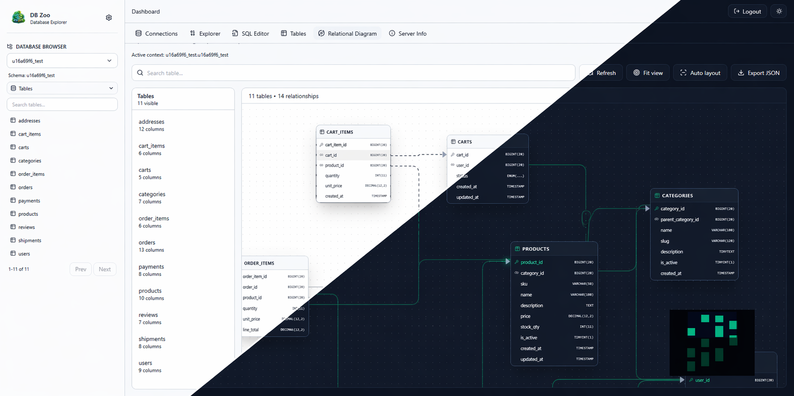

<p align="center">
  
</p>

> **Modern phpMyAdmin-inspired database management tool** built with Next.js App Router and TypeScript.



---

> [!NOTE]
> DB Zoo is designed to be a **lightweight, developer-friendly alternative** to traditional database GUIs — fast, extensible, and web-first.

---

## 🚀 Features

- 🌐 Web-based database management (no install needed)
- 🔌 Multi-database support (MySQL, PostgreSQL, SQLite, etc.)
- 🧠 Smart query editor with Monaco + history + safety checks
- 🗂️ Schema explorer (tables, indexes, relations)
- ✏️ Row-level operations (insert, delete, duplicate)
- 🔐 Secure credential handling (encrypted storage)
- ⚡ Fast, minimal, and developer-friendly UI
- 🧩 Provider abstraction for easy engine extension

---

## ❓ Why DB Zoo?

Traditional tools like phpMyAdmin are powerful, but often **clunky, outdated, or tied to specific stacks**.

DB Zoo takes a modern approach:

- ⚡ Built with **Next.js App Router**
- 🧩 Designed for **multi-database extensibility**
- 🎯 Focused on **developer experience**
- 🔐 Secure by default with encrypted credentials

---

## 📦 Installation

```bash
pnpm install
pnpm exec prisma migrate deploy
pnpm dev
```

---

## 🏃 Run

```bash
pnpm dev
```

Open your browser and start managing your databases.

---

## 🏗️ Build

```bash
pnpm build
pnpm start
```

---

## 🧰 Requirements

- Node.js 20+ (tested on 24)
- [pnpm](https://pnpm.io) 10+ (`corepack enable` is enough)

---

## ⚙️ Environment

Create a `.env` file:

```env
DATABASE_URL="file:./prisma/dev.db"
APP_ENCRYPTION_KEY="dev-32-byte-minimum-secret-key-12345"
SESSION_SECRET="dev-session-secret"
```

---

> [!IMPORTANT]
> - `APP_ENCRYPTION_KEY` must be **at least 32 bytes**
> - Never expose your `.env` in production

---

## 🧱 Tech Stack

| Layer        | Technology                          |
|-------------|------------------------------------|
| Frontend    | Next.js 16 (App Router), React 19, Tailwind 3 |
| Language    | TypeScript                         |
| Backend     | Route Handlers (API)               |
| Database    | Prisma (metadata DB)               |
| Validation  | Zod                                |
| Editor      | Monaco Editor                      |

---

## 🐘 Supported Engines

| Database     | Driver             | Status |
|-------------|-------------------|--------|
| MySQL        | `mysql2`          | ✅     |
| MariaDB      | `mysql2`          | ✅     |
| PostgreSQL   | `pg`              | ✅     |
| SQLite       | `better-sqlite3`  | 🔄     |
| MongoDB      | Planned           | 🔄     |

---

## 🧩 Project Structure

```
db-zoo/
├── app/                    # Next.js App Router pages + API routes
├── components/
│   ├── db-manager/         # Database manager feature components
│   └── ui/                 # Reusable UI components
├── lib/
│   ├── db/providers/       # Database engine abstractions
│   ├── services/           # Core backend logic
│   ├── validation/         # Zod schemas
│   ├── security/           # Encryption & auth
│   └── session/            # Session management
├── prisma/                 # Metadata schema and ORM config
├── public/                 # Static assets
├── styles/                 # Global styles
└── package.json
```

---

## 📝 Notes

- 🔐 Credentials are **encrypted on save** and never returned to clients
- ⏱️ Connection sessions expire after **24 hours** and are cleaned up automatically
- 👤 Saved connections are private to the browser that saved them (anonymous owner cookie, also 24 hours)
- 🛡️ Read-only connections block destructive queries
- 🧩 Some advanced operations are scaffolded for future engine-specific implementations
- 🗃️ Metadata DB is **separate from managed connections**

---

## 📝 Author

This project is created by [Servbase](https://github.com/servbase-net).

[](https://github.com/servbase-net/db-zoo/graphs/contributors)
---

💖☕ by [Servbase.net](https://servbase.net)
